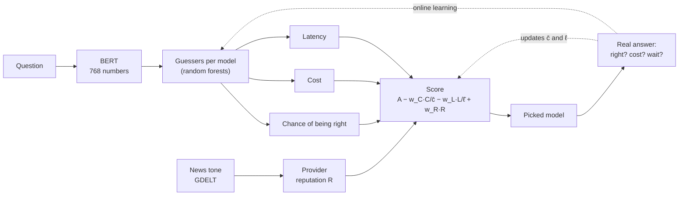

# ChainRouteLLM

**Blockchain-assisted adaptive routing across proprietary large language models.**
For every question, the router picks the model that gives a good answer without
costing too much or taking too long, and learns from the answers it sees. Its
performance evidence is meant to live on a shared, tamper-evident ledger.

---

## Roadmap

| Stage | What it adds | Status |
| --- | --- | --- |
| 1 | Router: BERT + accuracy and cost guessers | **Done** · merged |
| 2 | Comparison with MixLLM, online learning | **Done** · merged |
| 3 | Latency, provider reputation, live models | **Done** · merged |
| 4 | Comparison with recent routers from other researchers | Ongoing |
| 5 | Hyperledger Besu network | Planned |
| 6 | Attack tests | Planned |
| 7 | Router on the chain | Planned |
| 8 | Scale | Planned |

## How the router decides



- **w_C, w_L, w_R** are dials: how much the user cares about cost, waiting and the
  provider's public reputation.
- **c̄ and ℓ̄** are the cost and latency of a typical model, so cost and waiting are
  measured in "times a typical model".
- **R** is the provider's public reputation, from the tone of news coverage.

## Results at a glance

| | Setup | Headline |
| --- | --- | --- |
| **Stage 2** | RouterBench, 11 models, 80/20, 5 seeds | **98.1%** of GPT-4's quality at **30.3%** of its cost |
| **Stage 3** | 5 live models, 250 SuperGPQA questions, online, 5 seeds | **95%** of Opus's quality for **42%** less cost; **90%** for **88%** less cost and **35%** less latency |

Stage 3 figures are the best weight setting at each quality level, chosen after
the runs; the full trade-off curve is in `results/stage3/live_30_70.csv`.
Details are in each stage's section below and in `results/`.

## Project layout

| Directory | Purpose |
| --- | --- |
| `configs/` | Experiment configurations, model pools, and seeds |
| `data/` | Dataset inputs, processed data, and split manifests |
| `src/data/` | Dataset loading, validation, and preprocessing |
| `src/routing/` | Embeddings, predictors, routing policies, and online learning |
| `src/feedback/` | Feedback simulation and validation *(empty, later stages)* |
| `src/evidence/` | Evidence schema and storage adapters *(empty, later stages)* |
| `src/attacks/` | Controlled attack scenarios *(empty, Stage 6)* |
| `src/evaluation/` | Replay experiments, baselines, and metrics *(empty, later stages)* |
| `contracts/` | Solidity contracts and contract tooling *(empty, Stage 5)* |
| `infrastructure/` | Docker, Besu, and benchmark infrastructure *(empty, Stage 5)* |
| `tests/` | Automated tests |
| `results/` | Experiment reports, tables, and plots |

The planned experiments are described in [configs/experiment.json](configs/experiment.json);
the planning document `EXPERIMENT_PROTOCOL.md` is kept locally and is not in Git.

---

## Setup

Python 3.10 or newer (the live-model API clients need it). Run everything from
the repository root:

```bash
pip install -r requirements.txt
python -m pytest
```

> [!IMPORTANT]
> Calling the live models (Stage 3) needs API keys in a local `.env` file
> (`ANTHROPIC_API_KEY`, `OPENAI_API_KEY`). It is listed in `.gitignore` and must
> never be committed.

## Data preparation

```bash
python -m src.data.download_routerbench   # RouterBench pickles -> data/
python -m src.data.build_dataset --pickle data/routerbench_0shot.pkl
python -m src.data.splits --data data/processed/routerbench_0shot.csv.gz \
    --config configs/experiment_historical.json
```

| Step | Output |
| --- | --- |
| `build_dataset` | Each model's score, cost and answer length, cleaned in code, in `data/processed/<name>.csv.gz`, plus a `.report.json` with every removed row and the file checksums |
| `splits` | One manifest per seed in `data/splits/`; rows with the same prompt stay in the same split |

The processed tables are rebuilt by the script and stay out of Git; the reports
and split manifests are small and are committed. Local RouterBench pickle
downloads live in `data/` and are excluded from Git. `data/DataAnalysis.ipynb`
looks at the data and exports `df0_filtered.csv` and `df5_filtered.csv` for
reading; the experiments use the scripts' own table in `data/processed/`.

> [!WARNING]
> Do not open and re-save these CSV files in Excel: it changes the delimiter and
> the text encoding, and non-English prompts get garbled.

---

## Stage 1: router

The router learns to guess each model's accuracy and cost from the question's
BERT numbers, then picks a model with **score = accuracy − w_C · cost / c̄**, where
c̄ is the average offline cost over all models.

```bash
python -m src.routing.embeddings --data data/processed/routerbench_0shot.csv.gz \
    --config configs/experiment_historical.json      # BERT, about 17 min on an M3
python -m src.routing.archive.run_stage1 --data data/processed/routerbench_0shot.csv.gz \
    --config configs/experiment_historical.json      # about 1 min
```

- `embeddings` turns every question into BERT's numbers and saves them to
  `data/embeddings/` (large, stays out of Git).
- `run_stage1` learns from the offline questions, picks a model for every test
  question and prints how often each model is picked for each w_C. Add `--seed 23`
  for another split.

## Stage 2: comparison with MixLLM

For a fair comparison only, this stage uses MixLLM's setup: **11 models and an
80/20 train/test split**. The project design stays 30/60/10 with 5 models.

```bash
python -m src.data.build_dataset --pickle data/routerbench_0shot.pkl \
    --out data/processed/11_models/routerbench_0shot.csv.gz --models gpt-4-1106-preview \
    gpt-3.5-turbo-1106 claude-v1 claude-v2 claude-instant-v1 meta/llama-2-70b-chat \
    mistralai/mixtral-8x7b-chat zero-one-ai/Yi-34B-Chat WizardLM/WizardLM-13B-V1.2 \
    meta/code-llama-instruct-34b-chat mistralai/mistral-7b-chat
python -m src.data.splits --data data/processed/11_models/routerbench_0shot.csv.gz \
    --config configs/experiment_mixllm_8020.json --out-dir data/splits/80_20
python -m src.routing.archive.run_stage2 --data data/processed/11_models/routerbench_0shot.csv.gz \
    --config configs/experiment_mixllm_8020.json --splits-dir data/splits/80_20   # about 30 min
```

The 11-model table has the same questions as the 5-model one, so it reuses the
same BERT file. `run_stage2` runs the router for every seed with no online
learning and reports quality and cost as a share of always using GPT-4, the way
MixLLM reports them. Every seed's numbers go to `results/stage2/offline_80_20.csv`.

### Online learning

`src/routing/online.py` lets the router keep learning. It sees only the picked
model's real outcome, and every `update_interval` (1,000) questions it retrains
the forests of the models that got new answers.

| Flag | Effect |
| --- | --- |
| `--online` | learn from the split's online questions before the test |
| `--test-updates` | also learn from each test question after it is scored |

MixLLM's paper can be read both ways, so there are three runs. The 64/16/20 split
has the same test questions as the 80/20 one.

<details>
<summary>Commands for the three online runs</summary>

```bash
python -m src.data.splits --data data/processed/11_models/routerbench_0shot.csv.gz \
    --config configs/experiment_mixllm_64_16_20.json --out-dir data/splits/64_16_20
# 1. 64/16/20: learn online, then test
python -m src.routing.archive.run_stage2 --data data/processed/11_models/routerbench_0shot.csv.gz \
    --config configs/experiment_mixllm_64_16_20.json --splits-dir data/splits/64_16_20 --online
# 2. 64/16/20: learn online, then keep learning during the test
python -m src.routing.archive.run_stage2 --data data/processed/11_models/routerbench_0shot.csv.gz \
    --config configs/experiment_mixllm_64_16_20.json --splits-dir data/splits/64_16_20 --online --test-updates
# 3. 80/20: learn during the test
python -m src.routing.archive.run_stage2 --data data/processed/11_models/routerbench_0shot.csv.gz \
    --config configs/experiment_mixllm_8020.json --splits-dir data/splits/80_20 --test-updates \
    --out results/stage2/online_test_updates_80_20.csv
```

</details>

Add `--w-C` or `--seeds` to run only some w_C values or seeds; results go to
`results/stage2/<mode>_<split>.csv`.

---

## Stage 3: live models

Stage 3 measures latency on **real API models** instead of RouterBench's old
answers, and adds the provider's **public reputation**.

### 1. Questions and live answers

The questions come from **SuperGPQA** (`m-a-p/SuperGPQA`, ODC-BY licence):
26,529 multiple-choice questions from 13 disciplines, each with its correct
letter, so grading is automatic.

```bash
python -m src.data.supergpqa        # download SuperGPQA, write the question batches
python -m src.data.collect_live --batch data/supergpqa/batches/batch_1_90.csv
```

| Script | What it does |
| --- | --- |
| `supergpqa` | Writes three batches to `data/supergpqa/batches/`: the 10-question test run, then 90 and 150 questions from a seeded random draw (250 in all; near-identical questions are dropped and no question is in two batches) |
| `collect_live` | Asks every question of a batch to each model with the same settings (effort "low", at most 4,000 answer tokens), one timed call at a time per model. Appends every answer to `data/live/supergpqa_<batch>.csv`: correct or not, tokens, cost (USD), latency (seconds) and the call time |

`collect_live` stops calling a provider at its budget and, when run again, asks
only what is missing; `--models` asks only some of the models.

| Model | Accuracy | Median latency | Cost per 1,000 questions |
| --- | --- | --- | --- |
| Claude Haiku 5.5 | 62.0% | 2.9 s | $0.37 |
| Claude Sonnet 5.5 | 70.0% | 3.4 s | $4.81 |
| Claude Opus 5.5 | 77.6% | 5.3 s | $11.77 |
| GPT-6.1 Terra | 69.6% | 2.8 s | $1.02 |
| GPT-6.1 Sol | 73.6% | 3.7 s | $2.41 |

All five models answered all 250 questions.

> [!NOTE]
> A new OpenAI account is limited to 3 requests per minute and 50 per day per
> model. At that limit, set `GAP["openai"] = 20.5` in `collect_live.py`; the Build
> tier needs no spacing.

### 2. Router with latency and reputation

```bash
python -m src.data.live_table       # one table of the live answers (all five models)
python -m src.data.reputation       # each provider's news tone from GDELT -> R
python -m src.routing.embeddings --data data/processed/supergpqa_live.csv.gz \
    --config configs/experiment_stage3.json
python -m src.data.splits --data data/processed/supergpqa_live.csv.gz \
    --config configs/experiment_stage3.json --out-dir data/splits/live_30_70
python -m src.routing.run_live --config configs/experiment_stage3.json
```

**Score:** accuracy − w_C · cost / c̄ − w_L · latency / ℓ̄ + w_R · R

| Part | Where | What changed |
| --- | --- | --- |
| Latency guess | `predictors.py` | A latency forest per model, used when the data has latency |
| c̄ and ℓ̄ | `router.py` (`Scales`) | The cost and latency of a typical model (the mean over models of each model's own mean). They start from the warm-start answers and take in every answer seen online |
| Reputation R | `src/data/reputation.py` | Daily tone of news mentioning Anthropic or OpenAI from GDELT (2026-10-12 to 2026-11-11), averaged per provider and put on one scale: R = (tone − average over providers) / spread of the daily tones. Data in `data/reputation/` |
| Online learning | `online.py` | Also relearns latency and feeds c̄ and ℓ̄ |

Stages 1 and 2 are unchanged: no latency, no reputation and a fixed c̄.

### 3. Evaluation

`run_live` evaluates online the way online routers are evaluated:

- a **30% warm start** where every model's answer is known,
- then a **70% stream** graded as it goes: each block of 25 questions is routed
  and scored before the router learns from it.

For 5 seeds and a w_C × w_L × w_R grid, it reports quality, cost and latency on
the whole stream as a share of always using Opus. The router is compared with
the same router without learning, every single model, a random pick and the
oracle. Every seed's numbers go to `results/stage3/live_30_70.csv`; the earlier
run with the three Claude models only is kept as `results/stage3/live_30_70_claude.csv`.

| Quality kept vs always Opus | Cost saved | Latency saved |
| --- | --- | --- |
| ≥ 95% | −42% | −13% |
| ≥ 90% | −88% | −35% |
| ≥ 85% | −93% | −41% |

Each row is the best of the 486 weight settings at that quality level, chosen
after the runs. Most of the saving comes from the cheaper GPT models: against
the best mix of single models at equal cost, the router is about level.

`run_live.py` keeps a stage-neutral name because the later stages reuse it.
